# Human curriculum evaluation

Three independently human-trained policies, one training seed each. Different human intervention exposure confounds pure BC/sensor comparisons. The fourth PHP+BC arm was stopped and is not included.

## Human-assisted training

| Run | Decisions | Human decisions | Human % | Goals | Native fall cost | Sim seconds | Recorded wall minutes |
|---|---:|---:|---:|---:|---:|---:|---:|
| RGB+height / pref+RL | 4500 | 2176 | 48.4 | 24 | 7 | 898.0 | 14.0 |
| PHP depth / pref+RL | 4500 | 442 | 9.8 | 6 | 4 | 899.4 | 10.2 |
| RGB+height / pref+BC+RL | 4500 | 2398 | 53.3 | 20 | 7 | 897.8 | 10.2 |

Wall duration includes pauses between first/last recorded transitions. Final open/reset-abandoned segments are censored, not counted as failures. Native training cost is fall-only; obstacle contacts were not recorded. Training trajectories cannot be faithfully recovered because these datasets do not contain world poses. See full teacher-free evaluation trajectories instead.

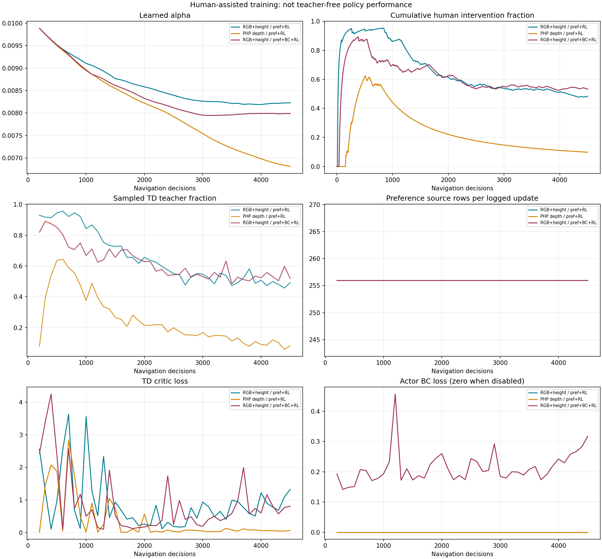

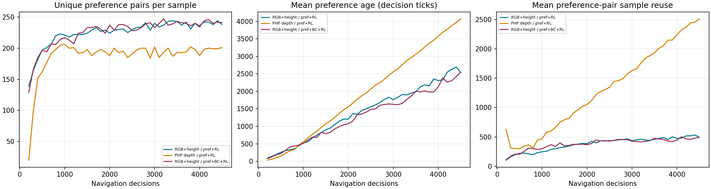

## Matched policy-only evaluation

No human gate or learning. Same arena geometry, low-level policy, initial robot states, goals, orientations and moving-obstacle phases; 5 Hz decisions, four 20 Hz ticks per decision, 180 s maximum per episode. Half the cases are unfiltered reset draws; half have verified static centerline blockage and a planner-feasible detour. The latter is a challenge stratum, not an unbiased deployment sample. Same training arena, new reset seeds; not held-out-terrain generalization.

**Safe success:** goal reached without a fall or any penetrating/touching robot-obstacle contact sampled at every physics substep. Ice/sand avoidance is a separate stricter material-safe metric. Contacts do not terminate episodes and are not called falls. Native cost remains fall-only; collision duration and maximum penetration are separate diagnostics, not a weighted cost or safety certificate.

| Run | Total success | Safe success | Material-safe success | Falls | Timeout | Contact episodes | Median successful time |
|---|---:|---:|---:|---:|---:|---:|---:|
| RGB+height / pref+RL | 0/8 | 0/8 | 0/8 | 6 | 2 | 3 | n/a |
| PHP depth / pref+RL | 3/8 | 2/8 | 1/8 | 2 | 3 | 4 | 18.0s |
| RGB+height / pref+BC+RL | 4/8 | 2/8 | 0/8 | 4 | 0 | 3 | 40.2s |
| Direct-goal controller (not RL) | 5/8 | 2/8 | 1/8 | 2 | 1 | 5 | 16.9s |

### Ordinary versus blocked cases

| Run | Stratum | Total success | Safe success | Falls | Contact episodes |
|---|---|---:|---:|---:|---:|
| RGB+height / pref+RL | unfiltered | 0/4 | 0/4 | 3/4 | 1/4 |
| RGB+height / pref+RL | blocked_detour | 0/4 | 0/4 | 3/4 | 2/4 |
| PHP depth / pref+RL | unfiltered | 2/4 | 2/4 | 1/4 | 1/4 |
| PHP depth / pref+RL | blocked_detour | 1/4 | 0/4 | 1/4 | 3/4 |
| RGB+height / pref+BC+RL | unfiltered | 2/4 | 2/4 | 2/4 | 0/4 |
| RGB+height / pref+BC+RL | blocked_detour | 2/4 | 0/4 | 2/4 | 3/4 |
| Direct-goal controller (not RL) | unfiltered | 2/4 | 2/4 | 1/4 | 1/4 |
| Direct-goal controller (not RL) | blocked_detour | 3/4 | 0/4 | 1/4 | 4/4 |

### Contact severity and duration

| Run | Total contact seconds | P95 episode contact seconds | Worst episode contact seconds | Max penetration mm | Mean episode seconds | Zero native-cost failures |
|---|---:|---:|---:|---:|---:|---:|
| RGB+height / pref+RL | 4.590 | 2.152 | 2.565 | 40.8 | 74.26 | 2 |
| PHP depth / pref+RL | 95.105 | 59.769 | 90.160 | 70.4 | 83.21 | 3 |
| RGB+height / pref+BC+RL | 36.770 | 22.694 | 33.875 | 78.8 | 33.89 | 0 |
| Direct-goal controller (not RL) | 6.160 | 1.969 | 2.160 | 48.6 | 37.79 | 1 |

Contact duration counts physics steps with one or more robot-obstacle contacts, not the number of contact points. Penetration is a geometric proxy, not impact force. P95 is a descriptive interpolated sample quantile; with eight cases it is not a reliable population tail estimate. Early falls shorten exposure, so a lower accumulated contact duration is not sufficient evidence of a safer policy.

### Interpretation boundaries

These are final saved policies, not performance during assisted training. There is one independently trained seed per configuration and unequal human supervision: PHP received far fewer intervention decisions, and its preference replay increasingly reused older examples. The comparison therefore does not isolate a causal BC or sensor effect. The geometric planner only screened blocked-case feasibility and never controlled an evaluated policy. No additional RL-only trained baseline was produced; direct-goal is explicitly a hand-coded reference.

Successful-time medians exclude failed episodes; mean episode duration, final/minimum goal distance, progress, zero-cost failures, cost/contact tails, ice/sand exposure and paired-case outcomes are in the CSV/JSON tables. Material exposure uses the robot base center, not a complete footprint. Direct-goal is a scan-blind hand-coded reference, not an RL-only trained arm.

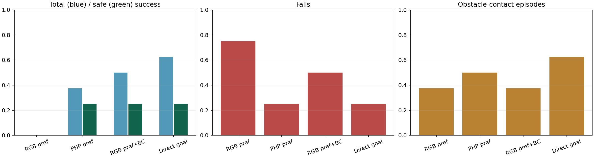

## Interactive policy inspection

Run one command at a time in Ubuntu WSL, then open http://localhost:8080 and press Pause / Run. These commands load the saved policy and perception settings without training or a gamepad gate. They inspect new interactive episodes, not an exact replay of the recorded matched manifest. The shared GPU lock prevents overlap with another study job.

### RGB+height / pref+RL

```bash
cd /home/benjamin/thesis
flock -n /tmp/unitree_core_gpu0.lock env MUJOCO_GL=egl /home/benjamin/miniconda3/envs/fasttd3/bin/python /home/benjamin/thesis/eval_interactive_unitree_nav.py \
  --model-path '/home/benjamin/thesis/models/unitree_mjlab_nav_human/human_20261105_163356_f43bdbee_r1_rgb_height_pref_rl/final.pt' \
  --checkpoint-env-config --viewer-backend viser --controller policy \
  --human-input-device none --observation-only --autopilot \
  --start-paused --sim-fps 20 --auto-reset --seed 7
```

### PHP depth / pref+RL

```bash
cd /home/benjamin/thesis
flock -n /tmp/unitree_core_gpu0.lock env MUJOCO_GL=egl /home/benjamin/miniconda3/envs/fasttd3/bin/python /home/benjamin/thesis/eval_interactive_unitree_nav.py \
  --model-path '/home/benjamin/thesis/models/unitree_mjlab_nav_human/human_20261105_163356_f43bdbee_r1_php_depth_pref_rl/final.pt' \
  --checkpoint-env-config --viewer-backend viser --controller policy \
  --human-input-device none --observation-only --autopilot \
  --start-paused --sim-fps 20 --auto-reset --seed 7
```

### RGB+height / pref+BC+RL

```bash
cd /home/benjamin/thesis
flock -n /tmp/unitree_core_gpu0.lock env MUJOCO_GL=egl /home/benjamin/miniconda3/envs/fasttd3/bin/python /home/benjamin/thesis/eval_interactive_unitree_nav.py \
  --model-path '/home/benjamin/thesis/models/unitree_mjlab_nav_human/human_20261105_163356_f43bdbee_r1_rgb_height_pref_bc_rl/final.pt' \
  --checkpoint-env-config --viewer-backend viser --controller policy \
  --human-input-device none --observation-only --autopilot \
  --start-paused --sim-fps 20 --auto-reset --seed 7
```

## Entire trajectory gallery

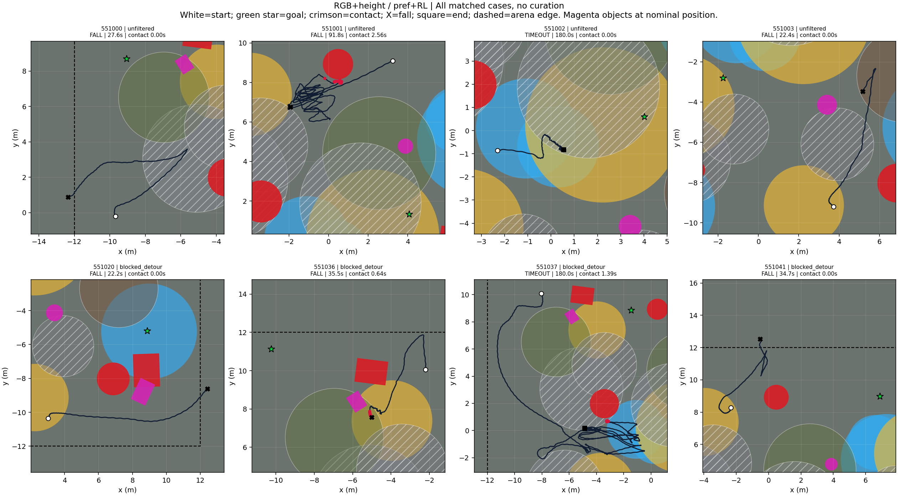

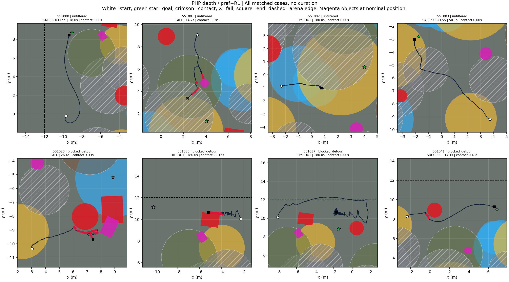

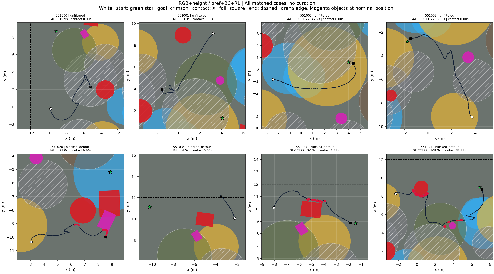

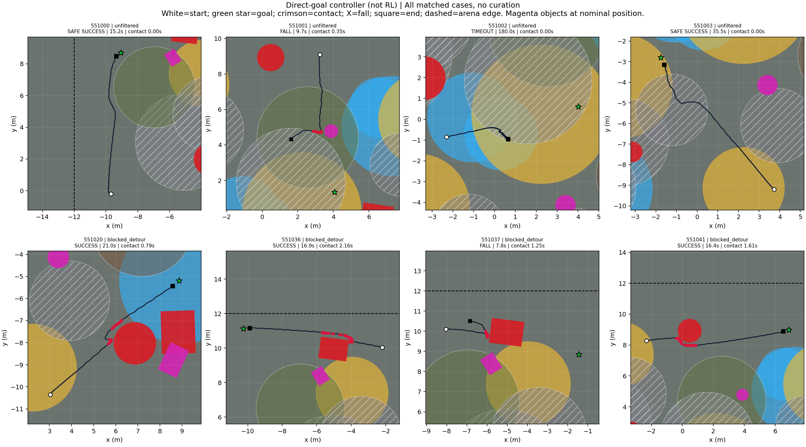

## Additional completed cases

37 additional episodes completed before switching to the requested eight-case comparison. Every additional trajectory is included below; these unequal per-policy samples are NOT pooled into the matched comparison. Selection for the main comparison was the first four cases per stratum in original manifest order, not outcome-based.

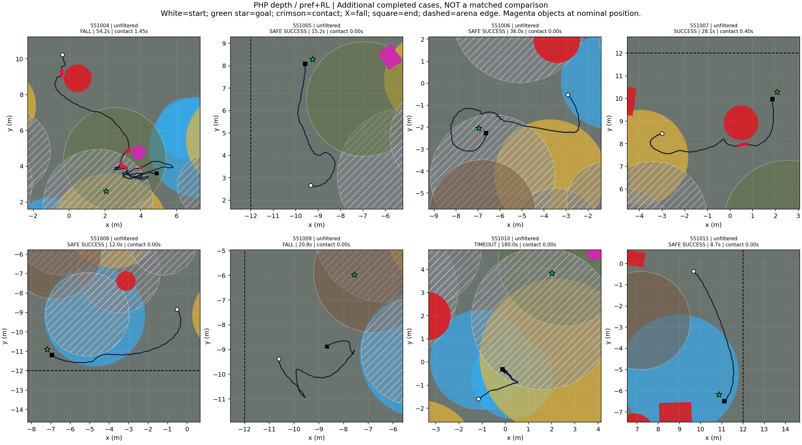

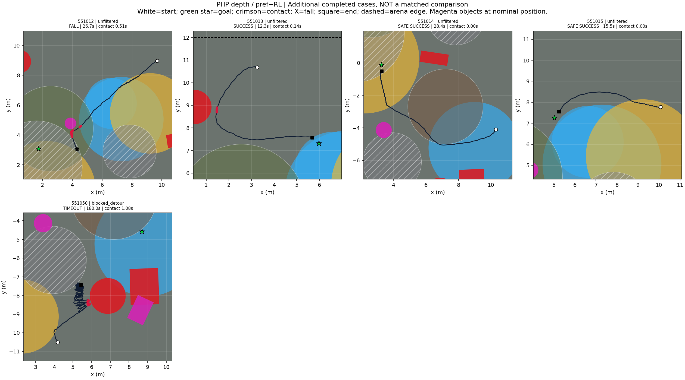

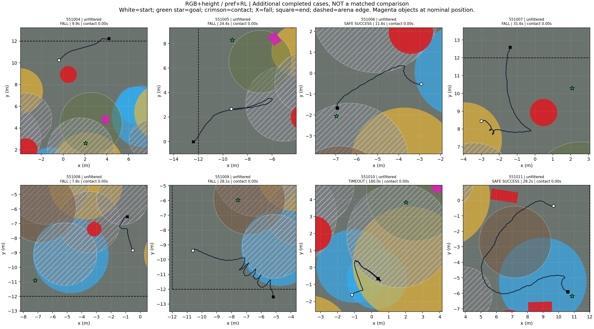

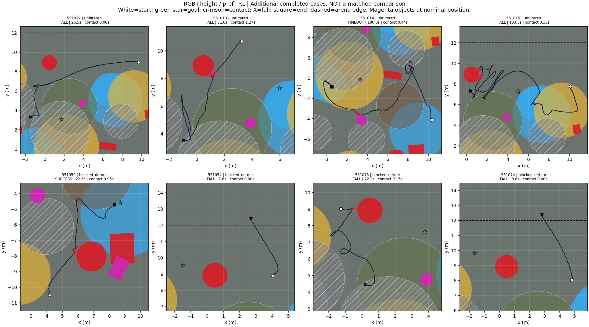

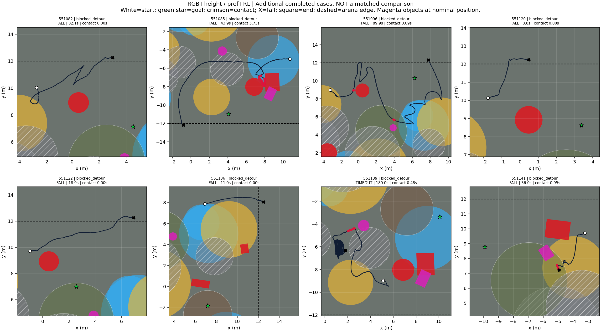
